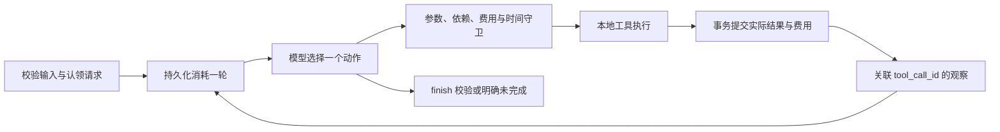

# 方案与取舍

采用 Python 3.12 标准库：argparse 提供 CLI；dataclasses 表达领域记录；Decimal 解析金额；sqlite3 保存原子结果；datetime/monotonic 计算时间；urllib 发送真实模型请求。没有 Agent 框架或模型 SDK，减少依赖与隐藏重试，代价是需要自行维护协议和状态守卫。

循环代码位于 `runner.py`；它不会选择替代形式。真实提供者发送当前状态与全部已发生的 assistant/tool 消息；模型选择估算什么、生成什么、重试或结束。Mock 提供者通过明确的条件分支模拟这些选择，日志标记 mock。草稿正文来自 generate_script 的模型参数，生成工具没有嵌套模型调用。工具素材是数据，不能覆盖系统规则；引用校验能证明来源存在，不能自动证明正文的全部语义真实性。

**依赖和重规划。** 检索返回最多三条正文；估算形成候选；生成必须有最新可行报价；生成改变账本和产物后需再估算才能保存。候选由形式、目标、受众、假设、素材及规则摘要确定。同条件重估只增加报价，成功脚本只复用，不改写；条件变化形成新版本，旧成功记录保留且标明当前不可复用。保存成功后只允许 finish。失败保存可由模型显式发起新尝试。

**费用。** 内部为整数百分单位。输入拒绝非字符串、非有限、负数和多于两位小数；无静默舍入。预计总费用 = 所有历史支出 + 当前候选剩余费用。估算、失败、拒绝、复用不收费；每个成功付费 attempt 最多一笔账。premium/standard/lean 分别为 12/8/3，生成时间 20/10/5 分钟；检索与保存各 1 分钟。详表在 [rules.json](../data/rules.json)。缺费用/耗时不得判为可行。结果的缺口限定于当前候选，同时给出已评估候选中的最低已知费用，不声称探索了无限可能方案。

**时间。** 输入带时区并转 UTC。实际累计耗时包含模型等待与运行开销；每次工具结算只补 `max(规则耗时−工具实际耗时, 0)`。逻辑时间 = 开始时间 + 实际累计 + 模拟补充，生效时间取实际 UTC 与逻辑时间较晚者；预计完成再加依赖链剩余工具耗时。模拟 1 分钟后模型等待 5 分钟累计 6 分钟；工具实际 8 分钟、模拟 10 分钟只累计 10 分钟。失败有规则耗时，换方案不清零。保存后到期仍保留产物但不能完成。

**状态与事务。** SQLite 只有 requests/events/ledger/artifacts 四表。请求 ID、调用尝试、最终方案均受唯一约束。每轮调用前持久化计数；实际工具先记 running，结算时原子提交结果、步骤状态、时钟、费用与保存方案，模型网络请求期间不持有写事务。崩溃或事务错误保留先前已提交内容，未提交费用不补记。recover 仅确认同主机原进程死亡后标为未完成，不自动续跑。这些保证只覆盖本地合成工具，不推广到远端业务恰好执行一次。

**幂等和证据。** 指纹包含规范化输入、模式、模型/端点身份、协议配置和决策提示版本、资料/规则内容及版本、故障、轮数；不含密钥、请求 ID 或导出目录。重复读取原始记录，冲突不修改原状态。完整证据通过同一个只读快照导出；manifest 最后写入并携带各文件摘要，若中途失败可重新 show 导出。导出不是跨文件原子提交，评审可用摘要识别不完整包；数据库仍为权威。

**DeepSeek 接入。** 当前实测 `deepseek-flash` + `/beta/chat/completions`，关闭 thinking，保留 required 单工具选择。仅发送 schema 时移除服务不支持的长度关键字，执行器仍校验完整 schema；HTTP 错误只记录安全状态码。Trace 保存响应 ID、实际模型名和 usage，不保存认证头或内部思维。生成成功观察提供同一候选的重估字段，防止模型把流程状态误写成业务条件。故障后优先评估替代形式是通用提示，实际选择仍由模型返回。协议依据和四次实际运行见 [真实验证](../examples/real/README.md)。

**运行边界。** 默认 12 次决策，finish/拒绝/模型故障都占轮次；第 12 轮只有保存而没有合法 finish 返回 limit_reached。真实 HTTP 无重试/重定向，最多 1 MiB 响应，30 秒 socket 超时。模型错误终止并保留成功成果；单一可关联工具调用的参数错误则返回 rejected 观察，让模型决定修正。

本期不实现同条件脚本改写、多用户 Runtime、跨主机恢复或失败步骤续跑。更完整的接口与实体约束见 [设计](../specs/001-content-planning-agent/plan.md) 和 [契约](../specs/001-content-planning-agent/contracts/model-and-tools.md)。
